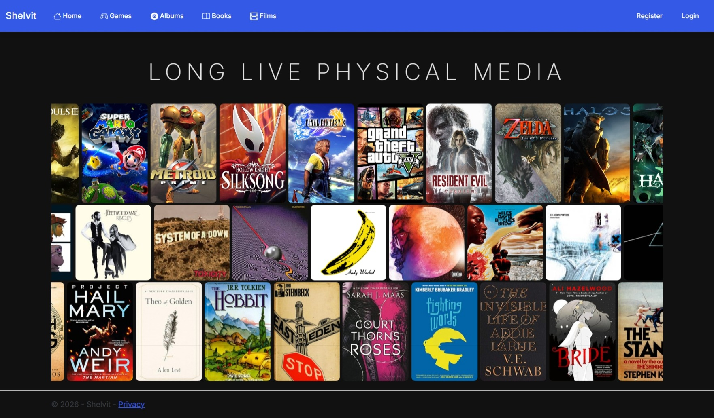
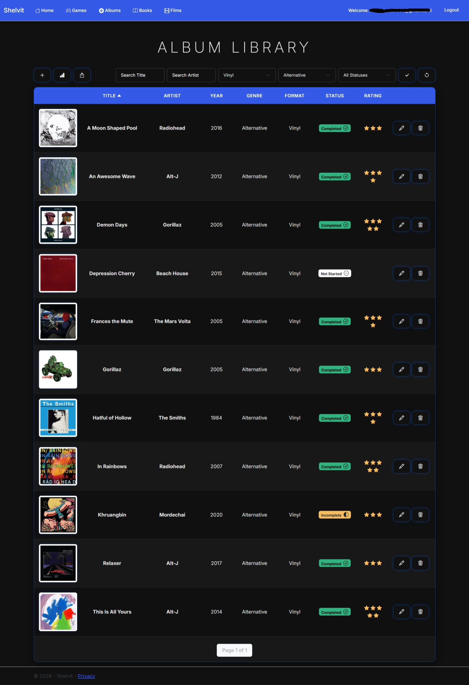
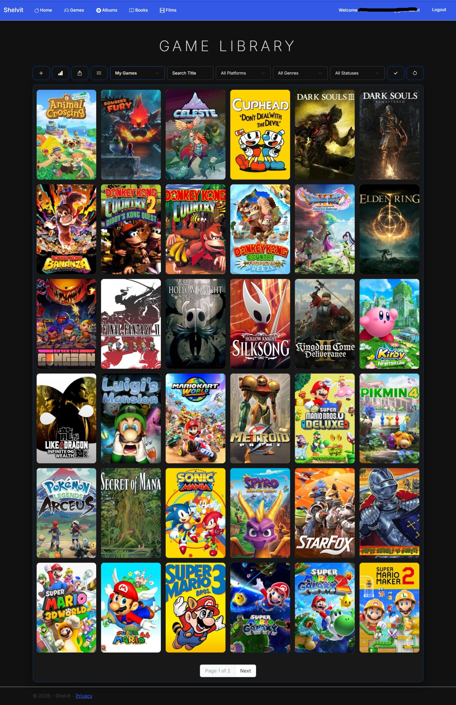
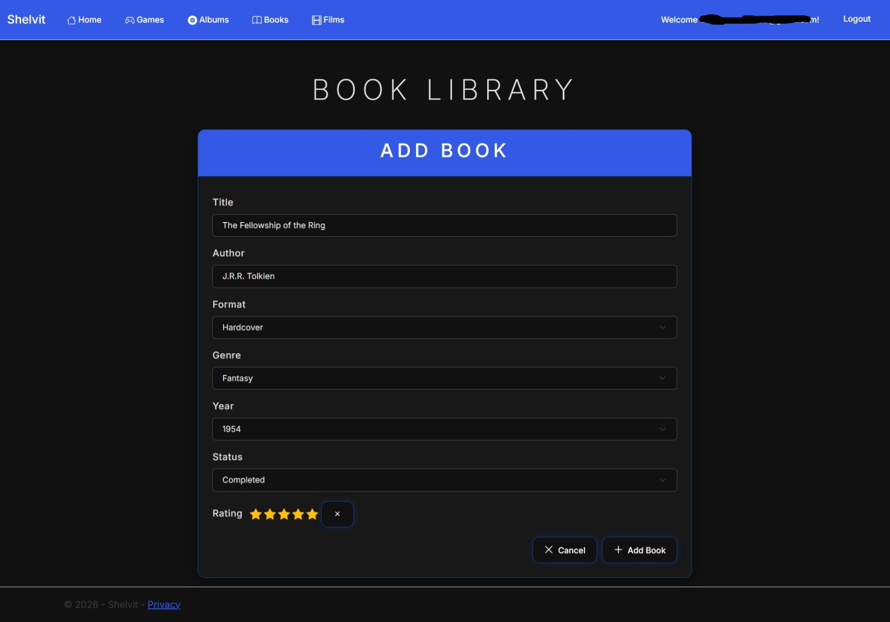
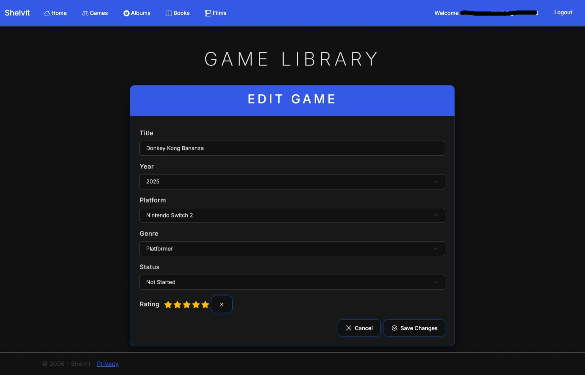
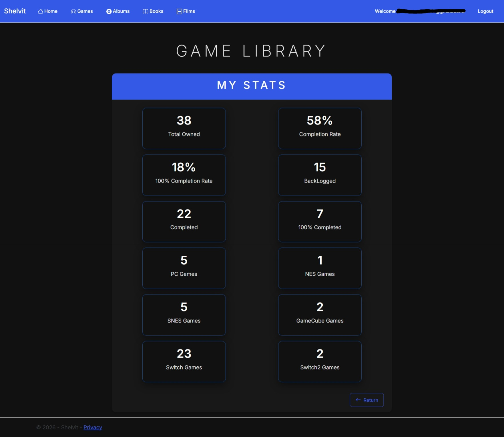
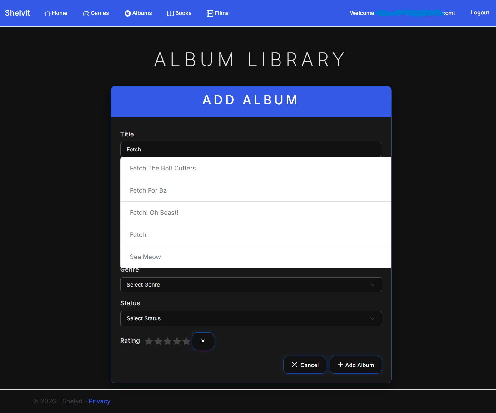

# Shelvit

Shelvit is a media collection management app for games, albums, and books built with ASP.NET Core MVC.

Users can organize their collections, track completion progress, rate items, and share their libraries with others.

Designed for physical media collectors and enthusiasts, Shelvit is your own digital bookshelf.

---

## Features

### Personalized Home Screen

* Cinematic scrolling cover art display
* Users see artwork from their own collections
* Dynamically adapts as the user's library grows

### Media Management

* Game library management
* Book library management
* Album library management
* Create, edit, and delete media entries
* Automatic data and image retrieval through external APIs
* Custom cover art support

### Collection Organization

* Search and filter by title, status, or genre
* Multiple sorting options
* Pagination for large collections

### Ratings & Progress Tracking

* Star rating system
* Status tracking
* Validation rules for incomplete items

### Statistics Dashboard

* Collection summaries
* Completion percentages and collection statistics

### Library Sharing

* Share collections through unique share tokens
* Shared users can browse, sort, and explore collections
* Visitors are guided toward creating their own Shelvit account

### Authentication

* User registration and login
* ASP.NET Identity integration
* User-specific collections

---

## Tech Stack

### Backend

* ASP.NET Core MVC (.NET 8)
* C#
* Entity Framework Core
* SQL Server
* ASP.NET Identity
* Dependency Injection

### Frontend

* Razor Views
* Bootstrap 5
* Bootstrap Icons
* JavaScript

### External APIs

* IGDB API
* RAWG Video Game Database API
* Spotify Web API
* Open Library API

---

## API Integrations

### IGDB API

Used for:

* Game metadata retrieval
* Cover art retrieval

### RAWG API

Used for:

* Game search
* Title and release year autocomplete suggestions

### Spotify API

Used for:

* Album search
* Album artwork retrieval
* Title, artist, and release year autocomplete suggestions

### Open Library API

Used for:

* Book search
* Title, author, and release year autocomplete suggestions

---

## Architecture

The application follows the ASP.NET Core MVC architecture pattern:

* Controllers handle HTTP requests and application flow
* Services contain business logic, external API communication, data searches, image retrieval, and statistic generation
* Helpers contain reusable logic for token generation, pagination, and building select item lists
* ViewModels shape data passed between controllers and views
* Razor Views provide the UI layer
* Entity Framework Core manages database access and persistence
* Dependency Injection manages service lifetimes

---

## Key Technical Challenges

### Spotify Authentication

Implemented OAuth Client Credentials Flow with token caching to reduce unnecessary authentication requests and improve performance.

### API-Driven Search

Integrated multiple external APIs to provide media search, metadata retrieval, image lookup, and autocomplete functionality.

### Shared Libraries

Designed a token-based sharing system allowing users to share collections publicly without exposing account information.

### Media Statistics

Built dashboard-style reporting and summary pages using aggregated collection data.

---

## Screenshots

### Home Screen Cinematic



### Album Library Table View



### Game Library Table View


### Create Book



### Edit Game



### Game Stats



### Album API Autocomplete



---

## Future Improvements

* Film Library feature
* Accessibility review
* Logging with ILogger
* Additional UI refactoring
* Azure deployment

---

## Getting Started

### Prerequisites

Before running the application, ensure you have:

* .NET 8 SDK installed
* SQL Server instance (LocalDB, Express, or full SQL Server)
* Database connection configured in `appsettings.json`

### Setup

1. Clone the repository
2. Update `appsettings.json` with your connection string
3. Apply Entity Framework migrations:

```bash
dotnet ef database update
```

4. Run the application

### Run

Launch the application through Visual Studio or:

```bash
dotnet run
```

---

## Author

Donny Hammond
GitHub: donnyhammond-dev
